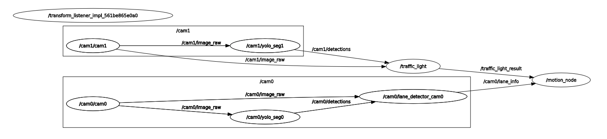

# 2025 성균관대학교 제3회 자율주행 SW 경진대회 — 🏆 금상 수상작

ROS 2 기반 1/10 스케일 자율주행 RC카 프로젝트입니다.
듀얼 웹캠(YOLO Segmentation) + RPLIDAR + Arduino 모터 제어로
**① 기록주행, ② 장애물주행, ③ 주차** 세 가지 미션을 수행합니다.

📺 **대회 라이브 영상**: [YouTube — 제3회 자율주행 SW 경진대회 생중계](https://www.youtube.com/live/r8NrDGU_-ZI?si=QQzTNkeyp87sog3y)
📰 **수상 소식 (성균관대 미래자동차공학과 공지)**: [제3회 자율주행 SW 경진대회 결과 안내](https://swb.skku.edu/futurecar/inform.do?mode=view&articleNo=59227&article.offset=0&articleLimit=10)

---

## 1. 시스템 개요

### 하드웨어 구성

| 구성 요소 | 역할 |
|---|---|
| 상위 PC (Ubuntu + ROS 2, CUDA) | 인식/판단 노드 실행 (`/home/sg/contest_ws`) |
| 웹캠 ×2 | cam0: 차선/장애물용 (전방 하단), cam1: 신호등용 (전방 상단) |
| RPLIDAR A1 | 장애물 감지, 주차 시 좌/우 차량 거리 측정 |
| Arduino Uno | DC 모터(좌/우 구동) + 조향 모터(가변저항 피드백) 제어 |

### 데이터 흐름 (노드 그래프)

실제 주행 중 `rqt_graph`로 캡처한 노드 구성 (기록주행 기준):



```
[cam0] ──image_raw──▶ [yolo_seg0] ──detections──▶ [lane_detector] ──lane_info──▶ ┐
[cam0] ──image_raw──────────────────────────────▶ [obstacle]  ──obstacle_result─▶ ├─▶ [motion_*] ──motion_command──▶ [control] ──Serial──▶ Arduino
[cam1] ──image_raw──▶ [yolo_seg1] ──detections──▶ [traffic_light] ─traffic_light_result▶ ┘
[RPLIDAR] ──/scan──────────────────────────────────────────────────────────────▶ ┘
```

- YOLO 커스텀 세그멘테이션 모델(`final.pt`)이 `lane1`(1차선), `lane2`(2차선), `traffic_light`, `car` 클래스를 검출
- 판단 노드(`motion_*`)가 미션별 로직으로 `MotionCommand(steering, left_speed, right_speed)`를 발행
- 제어 노드가 시리얼 문자열 `s{조향}r{우측속도}l{좌측속도}\n` 형태로 Arduino에 전달

---

## 2. 미션별 구성

### ① 기록주행 (Time Trial)

> 실행: `ros2 launch camera_pkg final.py` — 판단 노드: `decision_making_pkg/motion.py`

트랙을 최대한 빠르게 주행하는 미션.

- **차선 유지**: `lane_detect.py`가 YOLO 세그멘테이션 마스크를 BEV(Bird's Eye View)로 변환 →
  좌/우 경계에서 중앙선을 계산 → 중앙선 기울기(`steering_angle`)와 차량 횡방향 오프셋(`vehicle_position_x`)을 발행
- **조향 계산**: `조향 = 각도×0.7 + 횡방향오프셋×(-0.05)` 를 -10 ~ +10 단계로 클램프
- **차선 변경**: cam1이 신호등을 일정 크기(면적 threshold) 이상으로 3회 연속 감지하면
  목표 차선을 토글(1↔2)하여 지정 구간에서 차선을 변경
- 속도는 최대(255) 고정으로 기록 단축

### ② 장애물주행 (Obstacle Mission)

> 실행: `ros2 launch camera_pkg final_mission.py` — 판단 노드: `decision_making_pkg/motion_mission.py`

트랙 위의 장애물 차량을 피하고, 빨간불에 정지하는 미션.

1. **2차선 주행 중** LiDAR 측면(90° 부근)에서 장애물이 5회 연속 감지되면 → **1차선으로 변경** (1회만 실행)
2. **1차선에서** 카메라로 전방 장애물(`car`) bbox 면적에 따라 행동 결정:
   - 면적 < 5,000 (멀다) → 정지 대기
   - 5,000 ~ 12,000 (적당) → 저속 추종 직진
   - 12,000 ~ 15,000 (애매) → 정지
   - ≥ 15,000 (너무 가깝다) → 후진
3. 전진 추종 중 LiDAR에서 장애물이 사라지면(3회 연속) → **2차선으로 복귀**
4. **신호등**: cam1에서 빨간불이 크게(면적 > 18,000) 3회 연속 감지되면 정차, 해제되면 재출발

### ③ 주차 (Parking)

> 실행: `ros2 launch camera_pkg final_parking.py` — 판단 노드: `decision_making_pkg/motion_parking.py`

주차된 두 차량 사이 빈 자리에 후진 주차 후 탈출하는 미션. LiDAR만으로 동작하는 **8단계 FSM**:

```
SEARCH → FIRST_STOP → REVERSE_RIGHT → REVERSE_STRAIGHT
      → REVERSE_PAUSE → ADJUST_FORWARD → GO_OUT_TURN → GO_OUT_STRAIGHT
```

| 상태 | 동작 |
|---|---|
| `SEARCH` | 직진하며 우측(95~105°) LiDAR로 주차 차량 1대·2대 통과를 카운트 |
| `FIRST_STOP` | 두 번째 차량 통과 후 정지, 조향을 우측으로 프리셋 |
| `REVERSE_RIGHT` | 우측 조향 상태로 후진 → 좌/우 양쪽에 차량이 잡히면 자리에 진입한 것 |
| `REVERSE_STRAIGHT` | 좌/우 거리 차로 조향을 미세 보정하며 똑바로 후진, 양쪽 차량이 시야에서 사라지면 완료 |
| `REVERSE_PAUSE` | 주차 완료 상태로 수 초 정지 (심사 확인) |
| `ADJUST_FORWARD` → `GO_OUT_TURN` → `GO_OUT_STRAIGHT` | 전진 → 우회전 탈출 → 직진 이탈 |

`lidar_pkg/rear_parking_fsm.py`는 odometry yaw(회전각) 기반으로 동작하는 대안 구현입니다.

---

## 3. 패키지 구조

```
contest_ws/
├── driving/driving.ino              # ★ 실제 차량 Arduino 펌웨어 (조향+구동 모터)
└── src/
    ├── camera_pkg/                  # 인식 (Perception)
    │   ├── camera_pkg/
    │   │   ├── image_publisher.py   # 웹캠/비디오/이미지 → image_raw 발행
    │   │   ├── yolo_seg.py          # YOLO 세그멘테이션 → DetectionArray 발행
    │   │   ├── yolo_obj.py          # (Lifecycle 노드 버전, 미사용)
    │   │   ├── lane_detect.py       # BEV 차선 인식 → LaneInfo 발행
    │   │   ├── traffic_light.py     # 신호등 색상(HSV) 판별 → 문자열 발행
    │   │   ├── obstacle.py          # 전방 차량 감지(면적) → 문자열 발행
    │   │   ├── stop_line.py         # 정지선 감지 (로그만, 미사용)
    │   │   └── model/final.pt       # 대회용 커스텀 YOLO-seg 가중치
    │   └── launch/
    │       ├── final.py             # ① 기록주행 런치
    │       ├── final_mission.py     # ② 장애물주행 런치 (LiDAR 포함)
    │       └── final_parking.py     # ③ 주차 런치
    ├── decision_making_pkg/         # 판단 (Decision)
    │   └── decision_making_pkg/
    │       ├── motion.py            # ① 기록주행 로직
    │       ├── motion_mission.py    # ② 장애물주행 로직
    │       ├── motion_parking.py    # ③ 주차 FSM
    │       └── motion_test.py       # 카메라 전용 장애물 로직 (테스트용)
    ├── control_pkg/                 # 제어 (Control)
    │   └── control_pkg/
    │       ├── control.py           # MotionCommand → 시리얼 (스페이스바 시작/정지 토글)
    │       ├── parking_control.py   # MotionCommand → 시리얼 (토글 없는 단순 버전)
    │       └── keyboard_controller.py # WASD 수동 주행 + 학습 이미지 수집
    ├── lidar_pkg/                   # LiDAR 유틸 및 대안 주차 FSM
    └── interfaces_pkg/              # 커스텀 메시지 정의
        └── msg/ (LaneInfo, MotionCommand, DetectionArray, ...)
```

### 주요 커스텀 메시지

| 메시지 | 필드 | 의미 |
|---|---|---|
| `LaneInfo` | `steering_angle`, `lane_num`, `vehicle_position_x` | 중앙선 기울기(°), 현재 차선(1/2), 화면 중심 대비 횡방향 오프셋(px) |
| `MotionCommand` | `steering`, `left_speed`, `right_speed` | 조향 단계(-10~+10), 좌/우 모터 속도(-255~255) |
| `DetectionArray`/`Detection` | bbox, mask, class_name, score | YOLO 검출 결과 (lane1/lane2/traffic_light/car) |

---

## 4. 실행 방법

```bash
# 빌드 (Ubuntu, ROS 2)
cd ~/contest_ws
colcon build --symlink-install
source install/setup.bash

# 미션별 실행
ros2 launch camera_pkg final.py           # ① 기록주행
ros2 launch camera_pkg final_mission.py   # ② 장애물주행
ros2 launch camera_pkg final_parking.py   # ③ 주차

# 제어 노드는 별도 터미널에서 실행 (스페이스바로 출발/정지 토글)
ros2 run control_pkg control              # ①②용
ros2 run control_pkg parking_control      # ③용
```

> ⚠️ 런치 파일 내 카메라 번호(`cam_num`), 모델 경로, 시리얼 포트(`/dev/ttyACM0`, `/dev/ttyUSB0`)는
> 당시 대회 차량 기준 하드코딩이므로 환경에 맞게 수정 필요.

### Arduino 시리얼 프로토콜

- PC → Arduino: `s{조향}r{우측속도}l{좌측속도}\n` (예: `s-3r170l170`)
- 조향은 -10 ~ +10 단계. Arduino가 가변저항(포텐셔미터) 값을 읽어
  목표 조향각에 도달할 때까지 조향 모터를 돌리는 **폐루프 제어** 방식 (`driving.ino`)

---

## 5. 핵심 알고리즘 메모

- **차선 인식 파이프라인** (`lane_detect.py`):
  YOLO-seg 마스크 → 원근 변환(BEV) → 모폴로지 정제 → 행 단위 좌/우 경계 추출 →
  최장 연속 세그먼트 선택 → 2차 다항식 외삽 → 중앙선 계산 →
  한쪽 차선만 보이면 차선 폭(350px)의 절반으로 중앙선 추정 →
  둘 다 안 보이면 마지막 차선 번호 유지(fail-safe)
- **차선 선택**: lane1/lane2 중 차량 오프셋(`vehicle_position_x`)의 절댓값이 작은 쪽을 현재 차선으로 판단
- **오검출 억제**: 신호등/장애물/LiDAR 이벤트는 모두 N회 연속 감지 시에만 상태 전이 (디바운싱)
